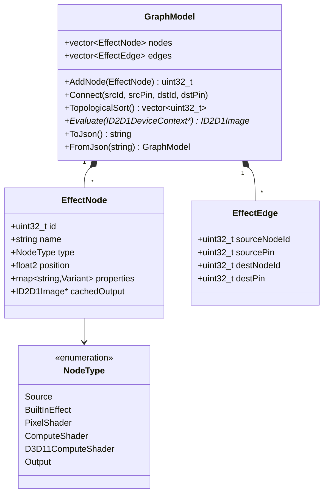

# Graph Model

`NodeType::Output` carries no shader — it is a sink that the evaluator draws to. Parameter and clock nodes (Float / Integer / Toggle / Gamut / Clock / Numeric Expression / Random / Working Space) have a `customEffect` with no HLSL; its `nodeKind` tells the evaluator which CPU-side data path publishes their fields (see [Parameter Nodes](../effects/parameter-nodes.md) and [Numeric Expression](../effects/numeric-expression.md)).

## Node contracts

What the evaluator does with a custom effect is declared on its `CustomEffectDefinition` (`Graph/NodeContracts.h`), not inferred from its name or its parameter names:

| Field | Values | Used for |
|---|---|---|
| `nodeKind` | `Shader`, `ConstantParameter`, `Clock`, `Expression`, `Random`, `WorkingSpace` | Which CPU path publishes a parameter node's fields; `EffectNode::IsClock()`; the Working Space sync and the video export's mastering lookup. |
| `dispatchShape` | `PerOutputPixel`, `SingleGroup`, `ReduceGroups`, `ImagePass` | A D3D11 compute node with an image output. Only `PerOutputPixel` is tiled by the evaluator, by the shader's reflected `[numthreads]`; the others dispatch `(1,1,1)` and the runner widens a reduction or image pass itself. |
| `outputExtent` | `{ sizeParam, columns, rows }` | A fixed output size from a float property: pixel shaders apply `sizeParam × columns` by `sizeParam × rows` (Color Checker: `PatchSize`, 6 × 4), and a generator without one is 512 × 512. D3D11 compute uses it as a square size of at least 64. |
| `injectedConstants` | `InputMask`, `OutputSize` | cbuffer values the evaluator writes: the connected-pin mask, and `OutputW`/`OutputH` (plus `ImageAW`..`ImageDH` where declared). |

Built-in descriptors set them (`ShaderLabEffectDescriptor`) and `CreateNode` copies them. Saved graphs write them as string tags. A graph saved before they existed derives each missing one on load with the rules the evaluator used to apply itself (`DeriveContracts`): the kind from the effect id (the ids are in `NodeContracts.h` and never change), the dispatch from the saved thread-group size and a `DiagramSize`/`OutputSize` parameter, the extent and injected values from the property names. A test loads every built-in with its contracts stripped and checks that derivation gives back what the descriptor declares, so an old graph renders as a new one does. A blank custom node, an Effect Designer *Add to graph* and *Update in graph*, and an `effect_compile` of an authored effect (one without a built-in id) derive theirs the same way, always from the node's own property map: host-injected values such as Split Comparison's `InputMask` / `OutputW` / `OutputH` are properties, not parameters, so deriving from parameter defaults alone would drop them. A built-in recompiled with `effect_compile` keeps what its descriptor declares. A D3D11 compute definition is always kind `Shader`, so a blank *Custom D3D11 Compute Shader* node is not mistaken for a parameter node; the canvas decides which nodes are parameter nodes from `nodeKind` too.

A compute shader's analysis fields are written by name: every compile defines `SL_FIELD_<name>` as the field's `Result` index (`AnalysisFieldMacros`), so the statistics shaders write `Result[SL_FIELD_Max]` rather than a literal that has to track the field list. `effect_compile` takes the field list from its own `analysisFields` argument when one is sent, so the baseline it stores and the variants built later use the same indices. A built-in's derived-constant tables are checked against the cbuffer variable sizes its HLSL declares, by a test and at run time (a mismatch is a node error).

## Changing a node

Every change to an existing node goes through a setter in `Graph/GraphEdits.h`, so the rule that pairs a change with its dirty flag lives in one place (decision #211):

| Setter | Writes | Dirty |
|---|---|---|
| `SetNodeProperty` | `properties[key]` (a typed value; untyped ones go through `WriteProperty`) | yes |
| `SetNodeMedia` | `mediaPath`; the host then prepares the source | yes |
| `RenameNode` | `name` | no: a label |
| `SetNodePosition`, `MoveNodes` | `position` | no: layout |
| `MarkNodeChanged` | -- something the node reads outside the graph changed | yes |
| `RetryNode` | clears `runtimeError` | yes |
| `ResetNodeOutput` | `cachedOutput = nullptr` | yes |
| `ReplaceCustomEffect` | `customEffect`, drops `cachedOutput`; the host calls `UpdateNodeShader` | yes |
| `SetBindingComponent` | a binding's source component | yes |
| `RecordNodeGpuTime` | `lastGpuMs`, `gpuState` (perf display) | no |

Each has a node form and a (graph, id) form that returns false for a missing node. A node still being built may have its fields set directly; `Effects::CreateCustomEffectNode` (an authored definition), `EffectRegistry::CreateOutputNode` and `Graph::NewInstanceOf` (another instance of a custom effect, without its bindings) build the common shapes.

## Source kinds

A Source node is an image, a Flood, a video or a live capture. `Graph::ClassifySource` (`Graph/SourceKind.h`) is the one place that reads the markers a saved graph records it with: the bool properties `IsDxgiDuplicateOutput`, `IsWindowsGraphicsCapture` and `IsVideo` (a marker counts only when true), else a media path, else the Flood CLSID. The file lives in `EffectNode::mediaPath`, saved under the JSON key `shaderPath`; older graphs also mirrored it into a `shaderPath` property, which loading folds into the field. An image node with an empty path has no file yet and is not an error.

## Source runtime

`Effects::SourceNodeFactory` builds Source nodes and keeps what feeds them, one entry per node id: the decoded image, the Flood effect, the video provider or the capture provider. `PrepareSourceNode` switches on `ClassifySource` to one function per kind (`PrepareImage`, `PrepareFlood`, `PrepareVideo`, `PrepareDesktopDuplication`, `PrepareGraphicsCapture`). Hosts call it through `Rendering::PrepareSources` (every Source, or the dirty ones and the videos each frame), then `TickAndUploadLiveCaptures` and `TickAndUploadVideos` advance the live ones; `PruneOrphans` at the top of each tick drops the entries of nodes that are gone or changed kind (decisions #162-#167).

- **Colour.** Every image a Source produces is linear scRGB (1.0 = 80 nits), FP16 where the source allows. `ImageLoader` flattens every file through ColorManagement to FP16; the video converter writes FP16; a capture surface is used as is when it is FP16 and decoded from sRGB by `AsLinearScRgb` (`Effects/SourceTextureUtil.h`) when the capture fell back to 8-bit. A capture node's `FP16` field reports which; its `RawFP16` property is only the request.
- **Errors.** No part of the runtime throws. A Source that cannot produce its image says why in `runtimeError`: the loader's stage and HRESULT for an image, the provider's `LastError()` for a video or capture, the exception message if anything else fails (the node is then left clean, so it neither stops the other Sources nor keeps the graph re-rendering). A lost capture (`CaptureResult::Failed`: a duplication that cannot be reopened after `DXGI_ERROR_ACCESS_LOST`, a failed resize, a WinRT failure) shows `Capture lost, retrying: <reason>`, has no output, and is reopened by the tick once a second until it returns; a capture with no image counts as failed even when no new frame is pending. A capture that fails to open when prepared keeps its `Failed to open ...` error, updated with each failed retry's reason, and is retried the same way; a video re-pointed at a file that does not open has no output. An exception from one capture's tick is reported on that node only.
- **Image cache.** A decoded image is reused while the file's path, write time and size are unchanged, checked when the node is prepared, so `MarkAllDirty` never re-decodes and a re-saved file does.
- **Analysis fields.** A video publishes `scVideoFields` (Duration, Position, Decodes, Uploads, UploadAttempts, FrameTime, Format) and a capture `scCaptureFields` (Width, Height, Frames, FP16), every one from creation and on every tick, so a binding to any of them never loses its source.
- **Threading.** The factory belongs to the thread that renders with it. A host whose render thread is not the one that created it names it with `SetOwnerThread`, and debug builds assert every call comes from there; the GUI's render worker does so for as long as it runs. The UI reads video state from `GraphUiSnapshot::videoSources`.

### Video

`VideoSourceProvider` is the glue between four pieces:

| Piece | Owns |
|---|---|
| `VideoFrameReader` | The Media Foundation Source Reader (hardware decode, then the video processor, then a bare reader), the stream's size, rate and duration, its `VideoColorDescription`, the negotiated output (P010 for HDR, NV12 for SDR, RGB32 as the fallback) and the copy of a decoded sample (CPU bytes, or the decoder surface for zero-copy). |
| `VideoSeekModel` | Measured decode and seek costs, the keyframes seeks have landed on, and the decision whether moving forward is cheaper as a seek ([video playback](../ui-ux/animation-system.md#video-playback)). |
| `VideoFrameConverter` | The upload textures, the planar texture zero-copy frames are copied into, and the conversion shader, recorded on a deferred context and submitted with one `ExecuteCommandList`. |
| `VideoSourceProvider` | The decode thread, its frame queue and seek/resume state (one mutex), playback position, and the D2D bitmap over the converter's output. |

`DescribeVideoColor` reads the stream's `MF_MT_TRANSFER_FUNCTION`, `MF_MT_VIDEO_PRIMARIES`, `MF_MT_YUV_MATRIX` and `MF_MT_VIDEO_NOMINAL_RANGE`. PQ and HLG are HDR and decode through P010; HLG gets the BT.2100 inverse OETF and a 1000-nit OOTF (75% signal = 203 nits). An untagged stream is PQ when its primaries are BT.2020 or it is HEVC Main 10, and SDR otherwise; untagged primaries and matrix follow (BT.2020 for HDR, BT.709 for SDR) and an untagged range is limited. The file name plays no part. The conversion shader is one template; the description sets its range, matrix coefficients, transfer and gamut as literal macros.

## Loading a graph

`GraphModel::FromJson` returns a graph ready to evaluate; no post-load call is needed. It:

- refuses a file with two nodes sharing an id (edges and bindings would be ambiguous);
- drops an edge or a binding that names a missing node, with a `runtimeError` on the node at the other end;
- sets `nextId` to at least one past the largest id, so `AddNode` never reuses one;
- reports an out-of-range `shaderType` or `analysisOutputType`, or an `outputExtent` multiplier outside 1-16384, on the node instead of casting it;
- writes each node's load report to stderr and the debugger output as well, because the evaluator replaces `runtimeError` on the node's first successful evaluate;
- derives any missing contract (above);
- does **not** compile HLSL. The evaluator compiles each node through the bytecode cache, with its variant and field macros, the first time it is needed; with async compile on, a node shows `compilePending` for its first frames.

`FindNode` returns a pointer into the node vector: `AddNode`, `RemoveNode`, `Clear` and assignment invalidate it.

---

Back to [docs/](../README.md) • [Repo root](../../README.md)