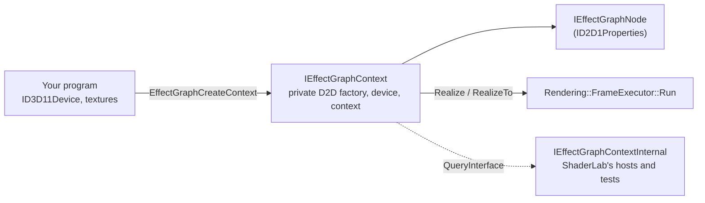

# EffectGraph API

EffectGraph is ShaderLab's engine as a library: the effect catalog, the graph and its evaluator, for any program that already has a D3D11 device. ShaderLab is the editor built on top of it. The public header is [`Engine/Api/EffectGraph.h`](../../Engine/Api/EffectGraph.h); it needs only the Windows SDK (no C++/WinRT, no STL), and the functions are exported from `EffectGraph.dll` ([Linking](#linking)).

```cpp
winrt::com_ptr<IEffectGraphContext> context;
EffectGraphCreateContext(d3dDevice, nullptr, IID_PPV_ARGS(context.put()));

winrt::com_ptr<IEffectGraphNode> input, stats, toneMap;
context->CreateTextureInput(hdrTexture, EFFECTGRAPH_INPUT_ENCODING_SCRGB_LINEAR, input.put());
context->CreateEffect(L"Luminance Statistics", stats.put());
context->CreateEffect(L"ICtCp Tone Map (HDR -> SDR)", toneMap.put());
stats->SetInput(0, input.get());
toneMap->SetInput(0, input.get());
toneMap->Bind(L"SourcePeakNits", stats.get(), L"Max");

context->RealizeTo(toneMap.get(), sdrTexture);   // a B8G8R8A8_UNORM_SRGB target gets sRGB 8-bit
```

## Shape



| Interface | What it is |
|---|---|
| `IEffectGraphContext` | Created from your `ID3D11Device`, which must have `D3D11_CREATE_DEVICE_BGRA_SUPPORT`; it builds a Direct2D factory, device and its own device context on it. Creates nodes (`CreateEffect` by name, `CreateEffectById` by a generated header's class id, `CreateD2DEffect`, inputs), evaluates them (`Realize`, `RealizeTo`), loads saved graphs (`LoadGraph`, `FindNode`), and hands out its D2D device (`GetD2DDevice`) for your own device contexts. |
| `IEffectGraphNode : ID2D1Properties` | A node. Values are read and written as a Direct2D effect's are. Also `SetInput`, `Bind`/`Unbind`, `GetValues`, `GetError`, the name. |
| `IEffectGraphInput` | Only input nodes (`CreateTextureInput`, `CreateImageInput`) answer it: `Invalidate`, `SetTexture`, `SetImage`. |
| `IEffectGraphValues` | A snapshot of a node's analysis fields on the CPU (`GetFloat(L"Max", &peak)`, `GetFloats` for vectors and histograms). |
| `IEffectGraphValuesBuffer` | A node's analysis fields on the GPU: the D3D11 buffer and view for your own shaders, a CPU read when you want numbers, and writes the rest of the graph sees. |
| `IEffectGraphContextInternal` | Not in the public header ([`EffectGraphInternal.h`](../../Engine/Api/EffectGraphInternal.h)): the graph, evaluator, sources and devices behind a context, for what the public API leaves out on purpose (canvas layout, the UI snapshot, Effect Designer compiles, MCP). Only for programs that link the engine library themselves, on contexts they created; not part of `EffectGraph.dll`'s contract. |

## Linking

NuGet packages carry all of this for other projects: `EffectGraph.Native` for C++ and the C# `EffectGraph` bindings ([EffectGraph Packages](../development/packaging.md)).

Outside programs link `EffectGraph.lib` and ship `EffectGraph.dll` (decision #219). The DLL holds its own copy of the engine and exports only the seven `EffectGraph*` functions; everything else reaches them as COM interfaces. Its build folder, `<Platform>\<Config>\EffectGraph\`, has the DLL, the import library and `include\` with `EffectGraph.h` and every built-in effect header. ShaderLab's own programs (the app, headless, the tests, `EffectGraphCompile`) link the engine library, `ShaderLabEngine.lib`, statically instead and define `EFFECTGRAPH_STATIC`, which makes the API's declarations plain `extern "C"` rather than `dllimport`.

### Versions

EffectGraph is versioned on its own, apart from ShaderLab (decision #229). `EffectGraph.h` includes [`EffectGraphVersion.h`](../../Engine/Api/EffectGraphVersion.h), which defines `EFFECTGRAPH_VERSION_MAJOR`, `_MINOR`, `_PATCH` and `EFFECTGRAPH_VERSION_STRING`; the packages take their version from it. A major version changes the C API, an interface or the effect blob incompatibly; a minor one adds to them. A shipped interface never changes in place: a new one gets a new IID.

Saved graphs carry `formatVersion` (`Graph::cGraphFormatVersion`, raised only when an older engine could not load the JSON safely) and `effectGraphVersion`, the version that saved them. A graph in a newer format is refused with both numbers in the message. Graphs saved before this carry ShaderLab's `appVersion` instead, which the message names.

## Rules

- **The context owns the nodes.** Releasing a node interface does not remove the node; `RemoveNode` does. Each node object holds its context. A node interface whose node was removed, or whose graph `LoadGraph` replaced, returns `EFFECTGRAPH_E_NODE_REMOVED`; one from another context is refused with `EFFECTGRAPH_E_WRONG_CONTEXT`.
- **One thread at a time** per context, like a Direct2D device context. Separate contexts may run on separate threads.
- **Asking for a result evaluates what it needs, and nothing else needs doing** (decision #221). `Realize`, `RealizeTo` and `GetValues` evaluate whatever the node depends on that changed; compute work (statistics, histograms) runs at once, and pixel shaders run when the image `Realize` returns is drawn, as with any D2D effect. The image is valid until the graph next changes; draw it with any device context you create on `GetD2DDevice`, including one that is drawing while the graph evaluates. `RealizeTo` draws the node into your texture and submits it to the device's immediate context, so your next D3D11 work sees the result.
- **There are no draw sessions to manage.** The context evaluates on a device context of its own that callers never see, and opens a session there only for a step that draws (a compute input it cannot read in place, an analysis readback, `RealizeTo`'s draw); a graph of compute on texture inputs opens none.
- **Inputs are read in place.** A linear-scRGB FP16 or FP32 texture is wrapped as a bitmap with no copy, and compute effects bind it directly (decision #209). sRGB 8-bit and HDR10 inputs are decoded to scRGB inside the graph.
- **Properties.** A wrapped Direct2D effect (`CreateD2DEffect`) exposes Direct2D's own property indices, names, types, defaults and sub-properties, answered by an instance of that class. A ShaderLab effect lists its declared parameters first, in order, then any other property. Writes go through `Graph::SetNodeProperty`; integer and boolean values are accepted for a float property. A bound property reads the value its binding resolves to now, which a binding served on the GPU never writes back to the node.
- **Shut down once.** `EffectGraphShutdown` joins the shader compiler's worker threads; call it after releasing every context, before the DLL unloads.

## Implementation

[`Engine/Api/EffectGraphImpl.h`](../../Engine/Api/EffectGraphImpl.h). `Context` and the node objects use C++/WinRT's `implements`, which answers `QueryInterface` only for the interfaces it lists, so each lists every level of its chain (`IEffectGraphContextInternal` and `IEffectGraphContext`; `IEffectGraphNode` and `ID2D1Properties`, plus `IEffectGraphInput` for an input node). A private `INodeIdentity` lets the context find the object behind a node interface it is handed. The context wraps exactly what `HeadlessEngine` owns: a `DeviceStack` built on your device (`Rendering::CreateDeviceStackOn`), a `GraphModel`, a `GraphEvaluator` and a `SourceNodeFactory`; every evaluation is one `FrameExecutor::Run` with the node as its demand root. Input nodes are Source nodes the context never prepares: it points their `cachedOutput` at the wrapped image before each frame.

## Shipping your own effects

An effect authored in ShaderLab's Effect Designer ships inside the program that uses it, compiled, so the program never runs the HLSL compiler (decision #213). Keep the Designer's `.json` in your project and import [`build/EffectGraph.targets`](../../build/EffectGraph.targets):

```xml
<Import Project="path\to\ShaderLab\build\EffectGraph.targets" />
<ItemGroup>
  <EffectGraphEffect Include="Effects\hdr_screenshot_tonemap.json" GpuBound="SourcePeakNits;WhiteErrorBudget" />
</ItemGroup>
```

Before the C++ compile, `EffectGraphCompile.exe` writes `hdr_screenshot_tonemap.effect.h`. Every build is in it; by default every build is compiled in. To keep only what the program uses, define `EFFECTGRAPH_COMPILE_ONLY_REFERENCED` and the selecting macros (the header lists them all) before including it:

```cpp
#define EFFECTGRAPH_COMPILE_ONLY_REFERENCED
#define EFFECTGRAPH_HDR_SCREENSHOT_TONEMAP_8BPC
#define EFFECTGRAPH_HDR_SCREENSHOT_TONEMAP_8BPC_TARGETGAMUT_SRGB
#define EFFECTGRAPH_HDR_SCREENSHOT_TONEMAP_8BPC_QUANTIZE_8_BIT
#define EFFECTGRAPH_HDR_SCREENSHOT_TONEMAP_8BPC_HUEANCHORSOURCE_SRGB
#define EFFECTGRAPH_HDR_SCREENSHOT_TONEMAP_8BPC_GPU_SOURCEPEAKNITS_WHITEERRORBUDGET
#include "hdr_screenshot_tonemap.effect.h"

EffectGraphRegisterEffects(&cHdrScreenshotTonemapEffect);   // at startup
context->CreateEffect(L"HDR Screenshot Tonemap (8bpc)", toneMap.put());
```

With the selection on, a build is compiled in when its effect's macro is defined, its GPU layout's macro is (the all-CPU layout needs none), and for each option it fixes, that value's macro or the option's `_ALL` macro is. An option with none of its macros defined is read at run time, and a selected effect's generic build is always in. Macro names are the effect, option and label names uppercased, each run of other characters one `_`. A misspelt macro selects nothing, silently: the preprocessor cannot report a name it was never told about.

- **What the header and blob hold** ([`Effects/EffectBlob.h`](../../Effects/EffectBlob.h)): the `.json` itself, as the description, and one record per build: its bytecode-cache key in the clear and its DXBC compressed on its own with LZMS (the Windows Compression API, in every Windows since 8). The builds are the generic one, every option combination, and the same again for every combination of the `GpuBound` parameters (bound to an analysis field and served on the GPU). The source is stamped with `IncludeLibraryHash()`, which covers the shared HLSL headers and the cache schema. `--out` writes the same as one `.bin` file, for `EffectGraphRegisterEffect`.
- **Registering** (`EffectGraphRegisterEffects` for a header, which keeps pointers into its arrays; `EffectGraphRegisterEffect` for a `.bin`, which is copied) adds each build to the bytecode cache as a pinned entry (never evicted, cleared or invalidated) holding only its compressed bytes, then registers the effects whose generic build is present, with no compile check. A build is decompressed the first time a node needs it, so memory follows what runs, not what ships. Other shared headers give `EFFECTGRAPH_E_INCOMPATIBLE_EFFECT`; builds that match none of the described effects, or damaged records, are invalid data.
- **A build the program left out is not compiled.** The cache refuses a prebuilt source's missing build unless the request allows it, and the evaluator's fallback takes over: drop the options, then the GPU routing, so a binding with no built layout is served from the CPU readback. Correct, just slower. `EFFECTGRAPH_CONTEXT_FLAGS_ALLOW_RUNTIME_COMPILE` (`EvaluatorOptions::compilePrebuiltEffects`) compiles it instead.
- **`EffectGraphCompile.exe`** parses the `.json` the way registration will, so its keys are the ones `CreateEffect` asks for at run time, and queues every build on a private bytecode cache's workers. The targets file lists the tool and the engine DLL beside it as inputs, so a new engine rebuilds the headers. Measured numbers are in the CHANGELOG entry.
## Effect plugins

A plugin is a DLL that adds effects to whichever EffectGraph loads it, without that program being rebuilt (decision #227). ShaderLab's private effects ship this way. The contract is [`Engine/Api/EffectGraphPlugin.h`](../../Engine/Api/EffectGraphPlugin.h), in the DLL's `include\` folder and the native package:

```cpp
#define EFFECTGRAPH_NO_STARTUP_REGISTRATION
#include "EffectGraphPlugin.h"
#include "MyToneMap.effect.h"          // EffectGraphCompile output, as above

EFFECTGRAPH_PLUGIN_EXPORT HRESULT WINAPI EffectGraphPluginRegister(IEffectGraphPluginHost* host)
{
    return host->RegisterEffects(&cMyToneMapEffect);
}
```

- **A plugin registers through the host, never through the C functions.** Calling `EffectGraphRegisterEffects` would load `EffectGraph.dll` and register into that DLL's engine, not the host's: ShaderLab links the engine statically and exports nothing. So a plugin does not link `EffectGraph.lib`, and turns off the generated header's startup registration. `IEffectGraphPluginHost` has `RegisterEffects` (a generated header, not copied) and `RegisterEffect` (a blob, copied). A later capability, such as CPU-side nodes, will be a new interface a plugin queries the host for, so a plugin built today keeps loading.
- **`EffectGraphLoadPlugin(path)`** loads it with its own folder first on the search path for its dependencies, calls `EffectGraphPluginRegister`, and keeps it loaded for the life of the process, since registered effects point into it. A second load of the same DLL is `S_FALSE`; a DLL without the export is unloaded again and refused with `ERROR_PROC_NOT_FOUND`. Any EffectGraph program can load a plugin: `EffectGraph.dll` exports the function and the C# bindings have `EffectGraphLibrary.LoadPlugin`.
- **Version skew is the blob's problem, not the plugin's.** The effects carry the shader-contract hash, so a plugin built against other shared HLSL headers gets `EFFECTGRAPH_E_INCOMPATIBLE_EFFECT` from `RegisterEffects`, and the host's interface itself does not change.
- **Nothing loads a plugin unless the program asks.** The engine never searches for plugins; a program using EffectGraph runs only the plugins it passes to `EffectGraphLoadPlugin`. That is the library's one guarantee here.
- **ShaderLab treats a plugin like any other effect** ([`Support/EffectPlugins.cpp`](../../Support/EffectPlugins.cpp)). It is a development tool and makes no security promise, so a plugin from anyone is loaded the same way as one of ShaderLab's own: every `.dll` in `Effects\` of the app's package and of every package it depends on (or beside the executable, unpackaged), and in the folders it already reads user effects from, the GUI's `%LOCALAPPDATA%\ShaderLab\effects` and headless's `--effects-dir`. Effect `.json` files and plugin DLLs can share a folder. The GUI and headless load them at startup, after `RegisterShaderLabSupport`.
- **Tests:** `TestEffectPlugin.dll` (`Tests/TestPlugin/`) is built the way a real plugin is, an Effect Designer `.json` through `build/EffectGraph.targets` into a header, linking nothing of EffectGraph (12.8 KB). `TestEffectGraphPlugin` loads it into the static engine and `TestEffectGraphPluginInDll` into `EffectGraph.dll`'s; both render its Gain effect exactly with no runtime compile.

## Analysis values on the GPU

`IEffectGraphNode::GetValuesBuffer` hands out a node's analysis fields where the GPU holds them (decision #222), so a program can feed statistics into its own shaders the frame they are computed without waiting for a readback. It evaluates the node first, as `GetValues` does, and reads nothing back.

```cpp
winrt::com_ptr<IEffectGraphValuesBuffer> values;
stats->GetValuesBuffer(values.put());
EFFECTGRAPH_FIELD_INFO max{};
values->GetFieldInfo(values->GetFieldIndex(L"Max"), &max);
winrt::com_ptr<ID3D11ShaderResourceView> view;
values->GetView(view.put());
// HLSL: StructuredBuffer<float4> Stats : register(t0);  float peak = Stats[maxElement].x;
d3dContext->CSSetShaderResources(0, 1, view.addressof());
```

- **Layout.** A `StructuredBuffer<float4>`; fields follow one another in `GetValues`' order, each from `EFFECTGRAPH_FIELD_INFO::bufferElement`. A scalar or vector takes one element (`x`, `xy`, `xyz`, `xyzw`), a `FLOAT_ARRAY` packs four values to an element, any other array takes one element per entry. This is the layout the `SL_FIELD_<name>` macros give a ShaderLab compute shader.
- **What you get.** A D3D11 compute node (Luminance Statistics, Channel Statistics, ...) hands out its own results buffer, so there is no copy. A node whose values are worked out on the CPU (Clock, Numeric Expression, the parameter nodes, the Direct2D Histogram) gets them uploaded into a buffer the context keeps, in the same layout. `GetBuffer` and `GetView` give the raw objects for any D3D11 call.
- **When it is current.** The buffer holds the values of the evaluation that `GetValuesBuffer` ran, until the node is evaluated again, which writes it again: in place for a compute node, on the next `GetValuesBuffer` for any other. D3D11 work you then submit on the device's immediate context runs after the writes. Ask the node again after each evaluation; the buffer can change when the node's fields do.
- **Reading on the CPU.** `ReadValues` copies the buffer to a staging buffer and maps it, which waits for the GPU; call it when you need the numbers, not every frame. `GetValues` does the same for a compute node. A context leaves compute results on the GPU unless something needs them on the CPU: a binding the GPU cannot serve still reads back, and nothing else does.
- **Writing.** `SetFloats` replaces one field until the node is next evaluated, and everything in the graph that reads the field sees the new value: the results buffer is written in place, the copy pixel shaders sample is refreshed, the node's CPU values (which bindings served as constants read) are updated, and the nodes bound to it are evaluated again. The node itself is not, which would write its own values back. Measured: a tone mapper whose `SourcePeakNits` is bound to statistics renders exactly what one with the property set by hand renders, after the statistics' `Max` is written (`TestEffectGraphValuesBuffer`).

## Drawing your own content into a graph

A program that draws with Direct2D (geometry, text, a gradient mesh) gives the result to a graph as an image input. Draw with a device context of your own on the context's D2D device; Direct2D cannot use resources from another D2D device together (its debug layer reports D1121, wrong resource domain). Colours are linear scRGB, as everywhere in the graph: 1.0 is 80 nits, and values above it are HDR.

```cpp
winrt::com_ptr<ID2D1Device> d2dDevice;
context->GetD2DDevice(d2dDevice.put());
winrt::com_ptr<ID2D1DeviceContext> created;
d2dDevice->CreateDeviceContext(D2D1_DEVICE_CONTEXT_OPTIONS_NONE, created.put());
auto dc = created.as<ID2D1DeviceContext2>();      // gradient meshes need ID2D1DeviceContext2

D2D1_GRADIENT_MESH_PATCH patch{};                 // point<column><row>; corner colours
// ... 16 control points over the area, color00/color03 = black, color30/color33 = {4, 4, 4, 1} (320 nits)
winrt::com_ptr<ID2D1GradientMesh> mesh;
dc->CreateGradientMesh(&patch, 1, mesh.put());

// Static content: record it once as a command list.
winrt::com_ptr<ID2D1CommandList> list;
dc->CreateCommandList(list.put());
dc->SetTarget(list.get());
dc->BeginDraw();
dc->DrawGradientMesh(mesh.get());
dc->EndDraw();
list->Close();
dc->SetTarget(nullptr);

winrt::com_ptr<IEffectGraphNode> drawn;
context->CreateImageInput(list.get(), drawn.put());
toneMap->SetInput(0, drawn.get());
```

Two ways to hand it over, and what each costs:

- **A command list** is recorded once and replayed by the graph wherever it is used, so it stores no pixels and has the exact bounds of what was drawn. It cannot change: for new content, record another and give it to the node with `IEffectGraphInput::SetImage`. A compute node cannot read one in place, so each dispatch that needs it draws it into a float copy first.
- **A bitmap you draw into** (`DXGI_FORMAT_R16G16B16A16_FLOAT`, premultiplied, `D2D1_BITMAP_OPTIONS_TARGET`) is read in place by compute nodes. For each new frame draw into it again and call `IEffectGraphInput::Invalidate`. Do not leave it the target of an open draw session while the graph reads it. An 8-bit bitmap would clip everything above 1.0, so keep HDR content in a float format.

Measured (`TestEffectGraphDrawnInput`, hardware adapter and WARP): a black-to-4.0 ramp over 64 x 32 comes through both ways with the expected linear values at every pixel centre (largest error 0.00000), and Luminance Statistics reads the last column's 317.500 nits exactly; redrawing the bitmap at twice the brightness and calling `Invalidate` doubles it.

## Built-in effects

ShaderLab's built-in shader effects are not in the engine DLL. Each one is a header that `EffectGraphCompile --builtins` generates from the `BuiltInEffects` library (decision #217): `luminance_statistics.effect.h`, `ictcp_tone_map_hdr_sdr.effect.h` and so on, plus `EffectGraphBuiltIns.h`, which includes all 30. A program has the built-ins whose headers it includes:

```cpp
#include "luminance_statistics.effect.h"   // registers itself when the program starts

winrt::com_ptr<IEffectGraphNode> stats;
context->CreateEffectById(CLSID_EffectGraphLuminanceStatistics, stats.put());
```

- **A header holds the effect's description and every build of it**, compressed, as a Phase 1b blob does: the generic build, each option value and each subset of its GPU-bindable parameters (46 builds for the 30 effects, about 1 MB of headers). Nothing compiles at run time.
- **It registers itself.** An inline variable calls `EffectGraphAddEffects` during static initialization, which only records a pointer, so it is safe under the loader lock of a DLL that includes the header. The engine parses the queued headers the first time its effect list is used. Define `EFFECTGRAPH_NO_STARTUP_REGISTRATION` to register with `EffectGraphRegisterEffects` yourself.
- **Each header defines its effect's class id**, `CLSID_EffectGraph<Name>`: a name-based UUID (version 5) of the effect id, so it survives renames. `CreateEffectById` with it makes a missing include a compile error; `CreateEffect` by name still works.
- **A missing header is named.** The engine keeps every built-in's name and id (`Effects::BuiltInEffectList`), so `CreateEffect` or `CreateEffectById` for a built-in the program did not include returns `EFFECTGRAPH_E_EFFECT_NOT_INCLUDED`, and MCP's `graph_add_node` says which header to include.
- **What stays in the engine:** the eight nodes with no shader (the four parameter nodes, Clock, Numeric Expression, Random, Working Space; Numeric Expression evaluates only where a host registered an expression language, which ShaderLab does and EffectGraph does not, decision #224), the shared HLSL includes, and the C++ three built-ins carry beyond their HLSL (the derived constants of ICtCp Gamut Map and ICtCp Boundary, Side by Side's output size), attached by effect id when they register.
- **Each header is checked against the engine** when it registers: its shader-contract hash must match, as for any blob.

ShaderLab's own programs (the app, headless, the tests) include `EffectGraphBuiltIns.h` through `build/EffectGraphBuiltIns.targets`, which runs the generator before C++ compiles.

## Moving to another device

`IEffectGraphContext::MoveToDevice` puts a context on another `ID3D11Device`: the GUI's adapter switch (decision #215) and recovery from a removed device (decision #220). It builds the new device stack first, a D2D factory and device with the engine's effects registered and a new device context, and fails with nothing changed when that fails, so a refused device leaves the context rendering where it was. Then it releases everything the old device made: the evaluator's effects, compute runners and scratch bitmaps, the sources' bitmaps and decoders, the metadata effects, and every input's wrapped image. The graph stays, with every node dirty, and so do the node interfaces (same objects, same epoch); effects rebuild and sources reopen on the next frame, a capture with the window or monitor it was given. What it cannot carry over is the caller's: images from `Realize`, device contexts made on the old `GetD2DDevice`, and the textures and images given to input nodes, which are empty until `SetTexture` or `SetImage` hands them one on the new device.

### When the device is removed

A removed device (a driver update or reset, a hung or unplugged GPU) is reported, not hidden: once `ID3D11Device::GetDeviceRemovedReason` fails, `Realize`, `RealizeTo` and `Draw` return that reason (`DXGI_ERROR_DEVICE_REMOVED`, `DXGI_ERROR_DEVICE_RESET`, ...) before doing any work, and a frame during which it happens returns it instead of `D2DERR_RECREATE_TARGET` or a node error. The caller recovers the way it handles any removed D3D11 device: create a new one and call `MoveToDevice`, then give input nodes new textures. The graph, the node interfaces and every property value carry over. Internally, `IEffectGraphContextInternal::RunFrame` reports it in `FrameResult::deviceRemoved`.

- **The GUI** checks the device's removed reason on the render worker every iteration and `Present1`'s result on the UI thread. Either one stops the worker's frames, and the next UI tick runs the adapter switch on the same preference (`MainWindow::RecoverDevice`). If no device comes up, nothing renders, the engine's MCP calls answer 503 at once instead of waiting out the dispatch timeout, and the tick tries again every 5 s.
- **Headless** moves its context to a new device on the same `--adapter` choice when a frame reports the device removed, and runs the frame once more (`HeadlessEngine::RecoverDevice`), so a long `--mcp-session` survives a driver reset.
- **Tests** remove a real device without touching the rest of the machine: a D3D11 device made with `D3D11On12CreateDevice` over a WARP D3D12 device is removed by `ID3D12Device5::RemoveDevice` (`TestEffectGraphDeviceRemoved`).

## Replacing the graph

`IEffectGraphContextInternal::ReplaceGraph` swaps the context's whole graph: the GUI's File > Open and MCP's `/graph/clear`, `/graph/load` and `/graph/load-file` use it (decision #216). It releases the old graph's effects and input images, opens the new graph's sources and bumps the context's epoch, so a node interface from before returns `EFFECTGRAPH_E_NODE_REMOVED` even when the new graph reuses its id. Media a host extracted for the new graph stays the host's (`IEngineCommandSink::OnGraphMediaDirChanged`). MCP routes reach the context through `Mcp::EngineContext`, which holds it beside the host's display monitor and hooks.

## ShaderLab's own hosts

Headless (decision #214), the GUI (decision #215) and the MCP routes (decision #216) run on a context, and so does the test runner (decision #218): each test case gets a fresh context on the shared D3D11 device, and the harness's `g_dc`, `g_d2dFactory` and `CaseEvaluator()` are that context's. A test may still build its own `GraphModel` and render it with them, since a graph is plain data; the device, the registered effects and the evaluator are always a context's.
