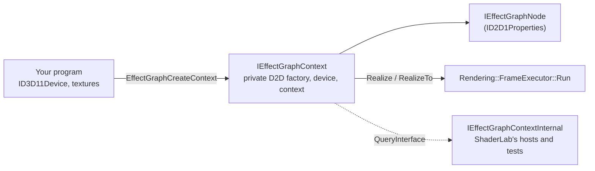

# EffectGraph API

EffectGraph is ShaderLab's engine as a library: the effect catalog, the graph and its evaluator, for any program that already has a D3D11 device. ShaderLab is the editor built on top of it. The public header is [`Engine/Api/EffectGraph.h`](../../Engine/Api/EffectGraph.h); it needs only the Windows SDK (no C++/WinRT, no STL), and the functions are exported from `ShaderLabEngine.dll`.

```cpp
winrt::com_ptr<IEffectGraphContext> context;
EffectGraphCreateContext(d3dDevice, nullptr, IID_PPV_ARGS(context.put()));

winrt::com_ptr<IEffectGraphNode> input, stats, toneMap;
context->CreateTextureInput(hdrTexture, EFFECTGRAPH_INPUT_ENCODING_SCRGB_LINEAR, input.put());
context->CreateEffect(L"Luminance Statistics", stats.put());
context->CreateEffect(L"ICtCp Tone Map (HDR -> SDR)", toneMap.put());
stats->SetInput(0, input.get());
toneMap->SetInput(0, input.get());
toneMap->Bind(L"SourcePeakNits", stats.get(), L"Max");

context->RealizeTo(toneMap.get(), sdrTexture);   // a B8G8R8A8_UNORM_SRGB target gets sRGB 8-bit
```

## Shape



| Interface | What it is |
|---|---|
| `IEffectGraphContext` | Created from your `ID3D11Device`, which must have `D3D11_CREATE_DEVICE_BGRA_SUPPORT`; it builds a Direct2D factory, device and its own device context on it. Creates nodes, evaluates them (`Realize`, `RealizeTo`), runs your drawing in a draw session (`Draw`), loads saved graphs (`LoadGraph`, `FindNode`). |
| `IEffectGraphNode : ID2D1Properties` | A node. Values are read and written as a Direct2D effect's are. Also `SetInput`, `Bind`/`Unbind`, `GetValues`, `GetError`, the name. |
| `IEffectGraphInput` | Only input nodes (`CreateTextureInput`, `CreateImageInput`) answer it: `Invalidate`, `SetTexture`, `SetImage`. |
| `IEffectGraphValues` | A snapshot of a node's analysis fields (`GetFloat(L"Max", &peak)`, `GetFloats` for vectors and histograms). |
| `IEffectGraphContextInternal` | Not in the public header ([`EffectGraphInternal.h`](../../Engine/Api/EffectGraphInternal.h)): the graph, evaluator, sources and devices behind a context, for what the public API leaves out on purpose (canvas layout, the UI snapshot, Effect Designer compiles, MCP). Its IID changes with every `SHADERLAB_ENGINE_ABI_VERSION`, so a host built against another engine gets `E_NOINTERFACE` instead of a mismatched layout. |

## Rules

- **The context owns the nodes.** Releasing a node interface does not remove the node; `RemoveNode` does. Each node object holds its context. A node interface whose node was removed, or whose graph `LoadGraph` replaced, returns `EFFECTGRAPH_E_NODE_REMOVED`; one from another context is refused with `EFFECTGRAPH_E_WRONG_CONTEXT`.
- **One thread at a time** per context, like a Direct2D device context. Separate contexts may run on separate threads.
- **`Realize` evaluates what the node needs.** Compute work (statistics, histograms) runs at once; pixel shaders run when the returned image is drawn, as with any D2D effect. The image is valid until the graph next changes. `RealizeTo` draws the node into your texture inside the frame's own draw session; `EndDraw` submits it to the device's immediate context, so your next D3D11 work sees the result.
- **Inputs are read in place.** A linear-scRGB FP16 or FP32 texture is wrapped as a bitmap with no copy, and compute effects bind it directly (decision #209). sRGB 8-bit and HDR10 inputs are decoded to scRGB inside the graph.
- **Properties.** A wrapped Direct2D effect (`CreateD2DEffect`) exposes Direct2D's own property indices, names, types, defaults and sub-properties, answered by an instance of that class. A ShaderLab effect lists its declared parameters first, in order, then any other property. Writes go through `Graph::SetNodeProperty`; integer and boolean values are accepted for a float property. A bound property reads the value its binding resolves to now, which a binding served on the GPU never writes back to the node.
- **Draw sessions do not nest.** `Realize`, `RealizeTo` and `Draw` called from inside a `Draw` callback return `D2DERR_WRONG_STATE`: evaluation opens its own session, and the D2D Histogram's readback opens yet another.
- **Shut down once.** `EffectGraphShutdown` joins the shader compiler's worker threads; call it after releasing every context, before the DLL unloads.

## Implementation

[`Engine/Api/EffectGraphImpl.h`](../../Engine/Api/EffectGraphImpl.h). `Context` and the node objects use C++/WinRT's `implements`, which answers `QueryInterface` only for the interfaces it lists, so each lists every level of its chain (`IEffectGraphContextInternal` and `IEffectGraphContext`; `IEffectGraphNode` and `ID2D1Properties`, plus `IEffectGraphInput` for an input node). A private `INodeIdentity` lets the context find the object behind a node interface it is handed. The context wraps exactly what `HeadlessEngine` owns: a `DeviceStack` built on your device (`Rendering::CreateDeviceStackOn`), a `GraphModel`, a `GraphEvaluator` and a `SourceNodeFactory`; every evaluation is one `FrameExecutor::Run` with the node as its demand root. Input nodes are Source nodes the context never prepares: it points their `cachedOutput` at the wrapped image before each frame.

## Shipping your own effects

An effect authored in ShaderLab's Effect Designer ships inside the program that uses it, compiled, so the program never runs the HLSL compiler (decision #213). Keep the Designer's `.json` in your project and import [`build/EffectGraph.targets`](../../build/EffectGraph.targets):

```xml
<Import Project="path\to\ShaderLab\build\EffectGraph.targets" />
<ItemGroup>
  <EffectGraphEffect Include="Effects\hdr_screenshot_tonemap.json" GpuBound="SourcePeakNits;WhiteErrorBudget" />
</ItemGroup>
```

Before the C++ compile, `EffectGraphCompile.exe` writes `hdr_screenshot_tonemap.effect.h`. Every build is in it; by default every build is compiled in. To keep only what the program uses, define `EFFECTGRAPH_COMPILE_ONLY_REFERENCED` and the selecting macros (the header lists them all) before including it:

```cpp
#define EFFECTGRAPH_COMPILE_ONLY_REFERENCED
#define EFFECTGRAPH_HDR_SCREENSHOT_TONEMAP_8BPC
#define EFFECTGRAPH_HDR_SCREENSHOT_TONEMAP_8BPC_TARGETGAMUT_SRGB
#define EFFECTGRAPH_HDR_SCREENSHOT_TONEMAP_8BPC_QUANTIZE_8_BIT
#define EFFECTGRAPH_HDR_SCREENSHOT_TONEMAP_8BPC_HUEANCHORSOURCE_SRGB
#define EFFECTGRAPH_HDR_SCREENSHOT_TONEMAP_8BPC_GPU_SOURCEPEAKNITS_WHITEERRORBUDGET
#include "hdr_screenshot_tonemap.effect.h"

EffectGraphRegisterEffects(&cHdrScreenshotTonemapEffect);   // at startup
context->CreateEffect(L"HDR Screenshot Tonemap (8bpc)", toneMap.put());
```

With the selection on, a build is compiled in when its effect's macro is defined, its GPU layout's macro is (the all-CPU layout needs none), and for each option it fixes, that value's macro or the option's `_ALL` macro is. An option with none of its macros defined is read at run time, and a selected effect's generic build is always in. Macro names are the effect, option and label names uppercased, each run of other characters one `_`. A misspelt macro selects nothing, silently: the preprocessor cannot report a name it was never told about.

- **What the header and blob hold** ([`Effects/EffectBlob.h`](../../Effects/EffectBlob.h)): the `.json` itself, as the description, and one record per build: its bytecode-cache key in the clear and its DXBC compressed on its own with LZMS (the Windows Compression API, in every Windows since 8). The builds are the generic one, every option combination, and the same again for every combination of the `GpuBound` parameters (bound to an analysis field and served on the GPU). The source is stamped with `IncludeLibraryHash()`, which covers the shared HLSL headers and the cache schema. `--out` writes the same as one `.bin` file, for `EffectGraphRegisterEffect`.
- **Registering** (`EffectGraphRegisterEffects` for a header, which keeps pointers into its arrays; `EffectGraphRegisterEffect` for a `.bin`, which is copied) adds each build to the bytecode cache as a pinned entry (never evicted, cleared or invalidated) holding only its compressed bytes, then registers the effects whose generic build is present, with no compile check. A build is decompressed the first time a node needs it, so memory follows what runs, not what ships. Other shared headers give `EFFECTGRAPH_E_INCOMPATIBLE_EFFECT`; builds that match none of the described effects, or damaged records, are invalid data.
- **A build the program left out is not compiled.** The cache refuses a prebuilt source's missing build unless the request allows it, and the evaluator's fallback takes over: drop the options, then the GPU routing, so a binding with no built layout is served from the CPU readback. Correct, just slower. `EFFECTGRAPH_CONTEXT_FLAGS_ALLOW_RUNTIME_COMPILE` (`EvaluatorOptions::compilePrebuiltEffects`) compiles it instead.
- **`EffectGraphCompile.exe`** parses the `.json` the way registration will, so its keys are the ones `CreateEffect` asks for at run time, and queues every build on a private bytecode cache's workers. The targets file lists the tool and the engine DLL beside it as inputs, so a new engine rebuilds the headers. Measured numbers are in the CHANGELOG entry.
## Not yet

- **`MoveToDevice`** (internal) returns `E_NOTIMPL` until the GUI's adapter switch moves into the engine.
- Headless runs on a context (decision #214); the GUI and the test harness still own their graphs directly and move in later phases.
