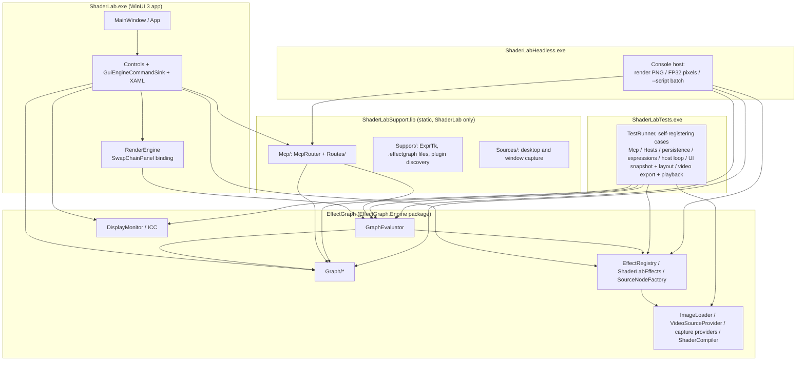

# Architecture Overview

The engine is [EffectGraph](https://github.com/Spruill-1/EffectGraph), a separate repository that ShaderLab consumes as the `EffectGraph.Engine` package (`EffectGraphEngine.lib`, linked statically into each program; decisions #231, #232). Everything else below is this repository.

---

Back to [docs/](../README.md) • [Repo root](../../README.md)