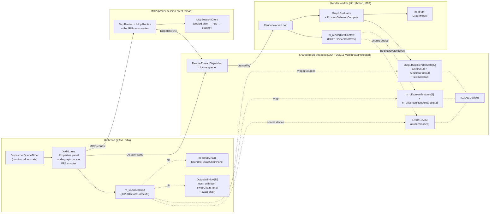
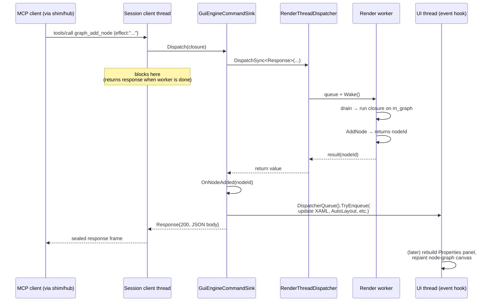
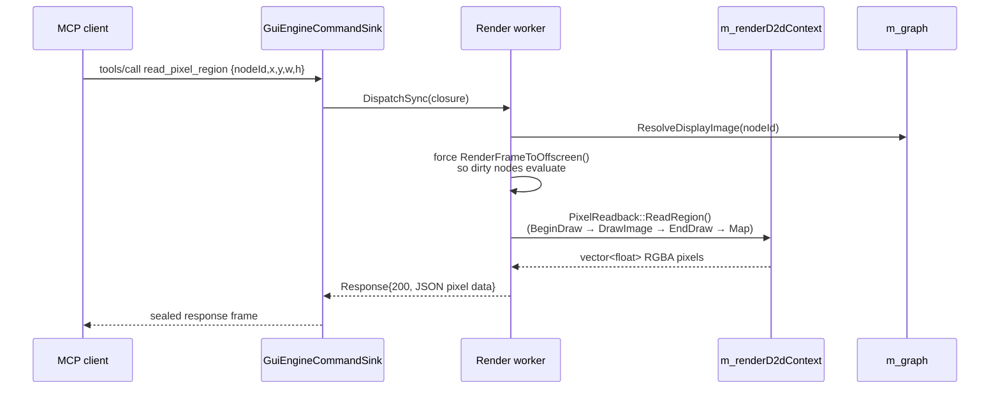
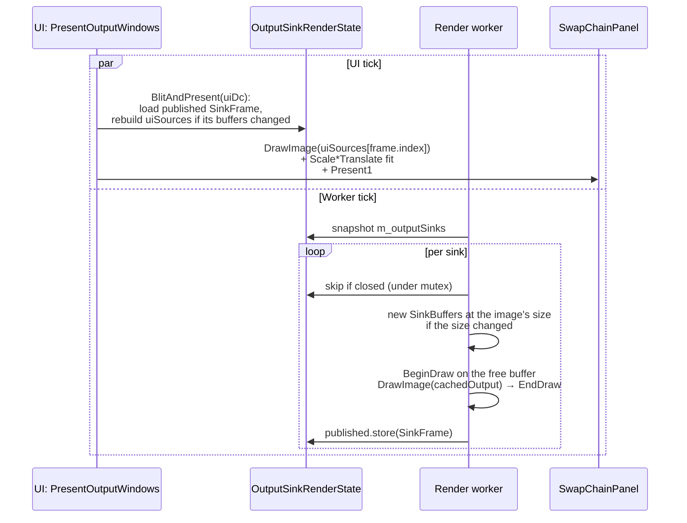
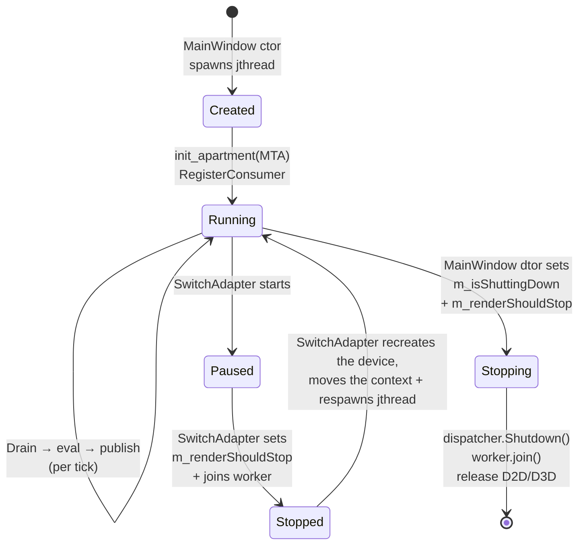

# Threading Model

ShaderLab uses a two-thread architecture: a **UI thread** (XAML STA) for input,
layout, and composition, and a **render worker** (`std::jthread` running MTA) for
all D3D11/D2D graph evaluation. They communicate through a closure-based
dispatcher and a double-buffered offscreen blit.

## High-level component map

Who owns what, and which thread accesses each piece. Solid arrows = ownership
(allocation + lifetime), dotted arrows = access from the other side.



## Per-tick sequence (steady state)

The "happy path" with no input, no MCP, no graph mutations — just the UI tick
draining new frames the worker produced.

```mermaid
sequenceDiagram
    participant UI as UI thread (STA)
    participant Disp as RenderThreadDispatcher
    participant W as Render worker (MTA)
    participant Off as Offscreen[2]
    participant Swap as SwapChainPanel

    loop @ monitor refresh
        UI->>UI: OnRenderTick fires<br/>(DispatcherQueueTimer)
        UI->>UI: UpdateFpsText / status bar
        UI->>UI: m_nodeGraphController.Render()<br/>(editor canvas, UI D2D ctx)
        UI->>UI: BlitOffscreenToSwapChain():<br/>compare publishedVersion vs m_lastBlitted
        alt new frame ready
            UI->>Off: wrap textures[publishedIdx] on UI ctx
            UI->>Swap: BeginDraw + DrawImage + EndDraw + Present1
        else no new frame
            Note over UI,Swap: skip Present;<br/>compositor keeps last frame
        end
        UI->>UI: PresentOutputWindows()<br/>(same blit pattern per Output)
    end

    loop @ FramePacer deadline (monitor refresh, 60-240 Hz)
        W->>Disp: WaitUntil(deadline), then Drain() any queued closures
        W->>W: AdvanceClocks, ResolveSourceBindings, TickAndUploadVideos,<br/>PropagateDirtyDownstream
        W->>W: RenderFrameToOffscreen(dt):<br/>PrepareSources, pick idx = published ^ 1<br/>FrameExecutor::Run (Evaluate → ProcessDeferredCompute →<br/>frozen sweep → BeginDraw, draw, EndDraw)
        W->>Off: publishedIdx.store(idx)
        W->>Off: publishedVersion.fetch_add(1)
        W->>W: RenderOutputSinks()<br/>(per-sink double-buffer + bufferGen)
    end
```

The two loops are independent — the UI tick never blocks on the worker, and
the worker never blocks on the UI. The handoff is two atomic stores per
frame.

### Frame semantics (one engine path for every host)

Every host renders a frame through `Rendering::FrameExecutor::Run` (decision
#133): the GUI worker's `RenderFrameToOffscreen` (with a draw callback for the
preview), headless `HeadlessEngine::RenderFrame` / `RenderFrameFor`, `ExportVideo`, and the tests. It
owns the ordering, and when draw sessions open, described in [hybrid compute](https://github.com/Spruill-1/EffectGraph/blob/main/docs/architecture/d2d-d3d11-hybrid-compute.md#known-limitations)
so no host copies it. The graph semantics it relies on live in `Graph/`:

| Concern | Owner | Rule |
|---|---|---|
| What is an edge | `GraphModel::ForEachDependency` | Image edges, then each node's distinct binding sources. The sort, the cycle check (`Connect`, `BindProperty`), dirty propagation and demand all walk it. |
| Dirty propagation | `GraphModel::PropagateDirtyDownstream` | Image edges only. A binding consumer is dirtied by the evaluator when the bound **value** changes, which a dirty producer has not done yet. |
| Demand (`needed`) | `GraphModel::ComputeNeeded` | Output nodes, dirty Typed-analysis nodes and the host's roots, walked upstream along edges **and** bindings. GUI roots: preview, readback node, open output windows. Headless image / pixels modes and `ExportVideo`: the rendered node. A host that may read any node next (headless MCP session, tests) demands everything (`FrameDemand::All`). |
| Frozen sweep | `FrameExecutor` | Runs `Evaluate(EvalMode::Frozen)` inside the session whenever a needed node is still dirty after `ProcessDeferredCompute`, whether or not anything dispatched (decision #134). |
| Clocks | `Graph/ClockModel` | `AdvanceClocks` (live tick: AutoDuration, Speed, Loop, UpdateRate buckets, non-loop stop) and `SetClocksToTime` (fixed timeline). |
| Sources | `Rendering/SourceRuntime` | `PrepareSources` (all, or dirty-or-video each frame; a failure lands on `runtimeError`) and `SettleVideoSources` for hosts with no render loop. |

The GUI-thread / render-thread split is unchanged: all of this runs on the
render worker, which is the only thread that touches the live graph, so the graph
has no lock (decision #207). No UI code reads the live graph: the Properties
panel's 4 Hz bound-value refresh reads `GraphUiSnapshot::hasDirtyNodes` and the selected node's bindings from the
snapshot.

### Render worker pacing

In the default (throttled) mode the worker runs on a deadline, not a fixed
sleep. `Rendering::FramePacer` keeps a grid of deadlines one period apart and
the worker blocks in `RenderThreadDispatcher::WaitUntil(pacer.WaitDeadline(now))`
for only the time left until the next one, so the frame's own work is
absorbed inside the period instead of added to it.

- **Rate.** `m_targetRefreshHz`: the monitor refresh rate clamped to
  60–240 Hz (`FramePacer::ClampRate`), the same value that drives the UI blit
  timer. Rendering faster than the UI can present is wasted work, and the
  60 Hz floor keeps 60 fps video and interaction smooth on 30 Hz modes. It
  is re-read every iteration, so a display change takes effect at once.
- **Timer.** `WaitUntil` waits on a high-resolution waitable timer
  (`CREATE_WAITABLE_TIMER_HIGH_RESOLUTION`) plus an auto-reset event the
  producers set. A condition-variable timeout rounds up to the 15.6 ms
  system tick: the old `WaitFor(16 ms)` actually waited ~31 ms and held the
  worker at ~32 Hz whatever the load. No process-wide `timeBeginPeriod`.
- **Early wake.** Queued closures, `Wake()` and `Shutdown()` end the wait
  at once. An early wake runs an iteration but does not move the deadline.
- **Overrun.** A frame that runs past its slot is followed by one frame after
  a 1 ms idle gap (`FramePacer::scOverrunIdle`); if a whole period was missed
  the grid restarts from now, so a long frame never causes a burst of
  catch-up frames. The gap keeps a worker that cannot meet its deadline from
  taking every moment between iterations. It was measured against the old
  graph lock, which the worker took exclusively twice per iteration: SRWLOCK
  is not fair, so a shared reader with no gap waited 0.6-1.1 s, against
  17.5-23 ms with it, for frames of 24 ms of work at 60 Hz
  (`RenderPacing_OverrunLetsReadersIn`). The graph lock is gone (decision
  #207); the gap stays so a lock the worker takes per frame cannot starve
  another thread.
- **Idle.** A static graph still wakes once per period (drain, clock tick,
  snapshot publish) but does not evaluate or spin.

Unthrottled mode (`perf_render_mode`) is unchanged: drain without blocking,
yield, loop.

## MCP mutation (e.g. `/graph/add-node`, `/graph/set-property`)

The `McpSessionClient` thread opens a sealed channel request, routes it
through `McpRouter` to the tool's route, and `GuiEngineCommandSink::Dispatch`
marshals the work. The sink posts a closure to the dispatcher and blocks
until the worker has run it. (The transport is the broker: shim → hub →
session over named pipes.)



The closure runs on the worker thread while no eval iteration is in flight
(the dispatcher drains the queue at the top of each loop). Re-entrant calls
from inside a worker closure are detected and run inline so a hook that
itself calls `DispatchSync` doesn't deadlock.

## MCP readback (`/render/pixel-region`, `/render/capture-node`, `/render/pixel-trace`)

Readback routes follow the same dispatch path but the closure body does the
heavy lifting (force a render, then `Map()` the staging texture or walk the
graph reading pixels).



The `Map()` call inside `PixelReadback` is synchronous — it blocks the worker
thread until the GPU finishes the copy. That's fine because the worker has
nothing else to do; the UI thread keeps ticking independently.

`/render/pixel-trace` follows the same shape but the closure body walks the
graph (`Rendering::TracePixel`) reading a 1×1 pixel from each node's
cachedOutput, once per node however many paths reach it.

## Output windows

Each Output node owns a `shared_ptr<OutputSinkRenderState>`. The window keeps
its pan / zoom / fit to itself and shares only a `closed` flag (under a mutex)
and the published frame. The worker (`Controls/OutputSinkRenderer`) draws the
node into the buffer of its current `SinkBuffers` allocation that the last
frame does not use and publishes a `SinkFrame {buffers, index, version}` with
one atomic store; a resize makes a new allocation rather than reseating the
old one's textures. The UI loads the frame once, so its buffer set, index and
version always agree, rebuilds its source bitmaps when the allocation
changed, and its `shared_ptr` keeps that allocation alive however far the
worker has moved on. Both contexts are on one multithreaded D2D device,
which orders the worker's write of a buffer after the UI's earlier read of
it.



The render side renders at the **source image's native size** (stateless about
panel display size or DPI). The UI side handles fit-to-panel on blit. This
keeps the worker free of XAML-context queries and lets each window's
`compositionScale` change without coordinating with the worker.

## User input on UI thread that mutates the graph

Drag-and-drop, Properties-panel slider edits, toolbar add-node, paste, etc.

```mermaid
sequenceDiagram
    participant U as User
    participant UI as UI handler
    participant Disp as RenderThreadDispatcher
    participant W as Render worker
    participant Graph as m_graph

    U->>UI: drop file on canvas
    UI->>UI: collect file paths (UI thread)
    UI->>Disp: DispatchSync(closure)
    Note over UI: UI thread blocks here<br/>(short — single eval iteration)
    Disp->>W: queue + Wake()
    W->>Graph: AddNode + FindNode<br/>+ PrepareSourceNode<br/>(render-side D2D ctx)<br/>+ AutoLayout
    Note over W,Graph: the new node starts dirty;<br/>nothing else needs invalidating
    W->>W: after-sync hook: publish GraphUiSnapshot
    W-->>Disp: complete
    Disp-->>UI: return
    UI->>UI: PopulatePreviewNodeSelector<br/>(XAML, reads the snapshot)
    UI->>UI: m_forceRender = true
```

Anything XAML-touching (panel rebuild, selector populate) stays on the UI
thread after the dispatcher returns and reads the `GraphUiSnapshot`. Anything
touching the live graph, layout, or D3D11/D2D goes inside the closure, including
source preparation, which uses the render D2D context. After every queued
`DispatchSync` closure the dispatcher runs an after-sync hook
(`SetAfterSyncClosure`) that republishes the snapshot before the caller is
released, so a UI read that follows a dispatched write sees it. Property edits
from the Properties panel (`Controls/PropertiesPanelController`) go through
`Graph::EditNodeProperty` (`Graph/GraphEdits`), which does the read-modify-write
and marks the node dirty in one closure; the panel reaches the render thread only
through its host's `editGraph`, a `DispatchSync`.

## Worker lifecycle



`Shutdown()` on the dispatcher cancels any pending `DispatchSync` waiters
with `std::runtime_error` so the MCP server thread / UI handlers don't hang.
The worker's outer loop checks `m_renderShouldStop` after each drain so a
mutation queued during shutdown still runs but the next eval pass is
skipped.

## Why two threads

Graph evaluation can take 50-100 ms per frame on heavy 4K HDR chains. Doing
that on the UI dispatcher starved input event delivery — dropdown highlights,
hover, and clicks visibly stalled. Decoupling makes the UI Present cost
sub-millisecond regardless of graph eval throughput.

## Why offscreen-blit (not direct Present-from-render-thread)

`IDXGISwapChain1::Present1` on a chain bound to a XAML `SwapChainPanel` throws
`RPC_E_WRONG_THREAD` from a render-thread MTA, even with multi-threaded D2D and
D3D11 `MultithreadProtected`. The XAML composition integration path is
STA-bound. The render thread therefore writes to offscreen `ID3D11Texture2D`
buffers; the UI thread blits the latest published buffer onto the
SwapChainPanel-bound swap chain.

## Resources

| Resource | Owned by | Notes |
|---|---|---|
| `m_d3dDevice`, `m_d3dContext` | `RenderEngine` | D3D11 immediate context with `ID3D10Multithread::SetMultithreadProtected(TRUE)`. Both threads call into it. Protection makes each *call* atomic, not a *sequence*: any multi-call GPU operation (bind shader/SRVs/UAVs, then `Dispatch`) must be recorded on its own deferred context and submitted with one `ExecuteCommandList(…, TRUE)`, or another thread's D2D work can land between the calls and the dispatch runs unbound. `D3D11ComputeRunner` and `VideoFrameConverter` both do this; each lost ~2–8% of dispatches, silently, before they did. |
| `VideoSourceProvider` frame queue | Decode thread fills, render thread takes | One mutex per provider guards the queue, the seek request, a seek generation number and the `VideoSeekModel` keyframe map; a frame decoded for an older seek is discarded. `Close()` releases the queued decoder samples before joining the decode thread, since a `ReadSample` waiting for a free decoder surface returns only when one is released. See [video playback](../ui-ux/animation-system.md#video-playback). |
| Multi-threaded D2D device | The EffectGraph context (`MainWindow::m_context`) | Built on `RenderEngine`'s D3D11 device by the context, which an adapter switch moves (`MoveToDevice`, decision #215). One device, three contexts, so images interop. |
| `m_d2dDeviceContext` | UI thread | `RenderEngine`'s, on the context's D2D device: the preview swap chain's back-buffer target. |
| `m_uiD2dContext` | UI thread | Editor canvas, blit-to-swap-chain, output-window blits, graph capture. |
| `m_renderD2dContext` | Render thread | The context's own device context: graph eval per tick, with a draw session only for the preview's draw (and any step that draws). |
| `m_swapChain` | Bound to UI's `SwapChainPanel`. UI thread Presents. |
| `m_offscreenTextures[2]` + `m_offscreenRenderTargets[2]` | Render thread writes; UI thread reads via `m_offscreenSourceBitmapUi[2]` (UI-context wrappers). |
| The live graph (`Model()`, the context's `GraphModel`) | Logical single writer/reader on render thread. UI mutations route through `RenderThreadDispatcher::DispatchSync` (worker drains the queue between iterations, so a closure runs while the worker is implicitly paused). |
| `m_outputWindows` (XAML) | UI thread only. The worker never iterates it: its evaluation roots for output windows come from the open (`!closed`) entries of `m_outputSinks`. |
| `m_outputSinks` (`OutputSinkRenderState`) | shared_ptr<>; UI thread mutates the vector under `m_outputSinksMutex`; render thread snapshots and reads. Every path that clears `m_outputWindows` (graph load, graph clear, adapter switch) clears the sinks too. |
| `SourceNodeFactory` (video providers, live sources) | Render thread only, including `SetLiveSourceTarget` (the WGC picker dispatches it with the picked item). The render worker names itself the owner (`SetOwnerThread`) while it runs, and debug builds assert every call comes from the owner; with the worker stopped (startup, adapter switch) the UI thread may call it. The UI reads video playback state (position, duration, size, frame rate, loop, uploads) from `GraphUiSnapshot::videoSources`, a value copy taken when the snapshot is published. `VideoProviderForRenderThread` is for render-thread callers and tests. A capture node is re-pointed at its source's current image every tick; while the capture is lost it has no output (`Live source lost, retrying: <reason>`), so the graph downstream of it pauses until the tick's once-a-second reopen succeeds. |
| `NodeGraphController::m_needsRedraw`, `MainWindow::m_isShuttingDown` | `std::atomic<bool>`. The worker sets the redraw flag; paint clears it *before* drawing, so a request raised mid-paint survives. |
| `GraphEvaluator` options | `SetOptions` and the `Performance::` default setters may be called from any thread (UI flyout, MCP routes). The evaluator copies its options once at the start of each Normal `Evaluate` into a per-frame copy and holds them for the frame, so a toggle lands on the next frame and never mid-frame. The GUI's evaluator follows the process defaults; headless pins its own. |
| `BytecodeCache` workers | Started by the first queued compile or reap, not at construction; joined by `Engine::ShutdownEngineServices`, which the GUI calls when the main window closes and headless and the tests call on every exit path. The disk reap is a job on the same queue, so nothing in the engine detaches a thread. The GUI's call can come while the render worker still runs: `GetOrCompile` keeps compiling inline, async `RequestCompile` calls are dropped, and `Shutdown` keeps any placeholder a compile is filling (`compilesInFlight`). |
| `GpuTimer` | `SetEnabled` stores only the atomic flag, from any thread. The render thread abandons its in-flight query slots at the next `BeginFrame`; per-node results are render-thread only. |
| Pixel trace | `Rendering::TracePixel` runs on the render thread and returns the tree by value; the panel (`PixelTracePanelController`) keeps its own copy, and the clicked point lives only in the UI, so an MCP `pixel-trace` neither rebuilds the tree under the UI's walk nor moves the user's point. MCP traces use the requested node's bounds. |
| Preview view (`Rendering::PreviewViewState`) | Node, selection, pan / zoom, auto-fit and per-node memory behind one mutex. The UI, MCP routes and the worker all edit it; the worker reads one `PreviewFrame` per frame and posts its fit back with `FitTo`, which is dropped when the view was edited after the frame began (every edit bumps a version), so a wheel zoom is never overwritten by a fit computed from the frame before it. |
| Canvas drags | A node or slider drag updates the visuals on the UI thread at once and queues one coalesced write (`DispatchAsync`, at most one pending) of the latest positions or value; release waits for the last write with `DispatchSync`. The pointer never waits on a worker tick mid-drag. |
| Canvas layout | `RebuildLayout` / `AutoLayout` check that they run on the dispatcher's consumer thread, or with no consumer registered (startup, adapter switch); a debug build asserts, a release build logs. |

## Dispatcher

`Rendering::RenderThreadDispatcher` is a closure queue with one consumer (the
worker) and many producers (UI thread, MCP server thread). `DispatchSync`
blocks until the closure has run and returns its result. Re-entrant calls
from inside the consumer thread run inline (the dispatcher detects this with
a thread-local flag). The consumer waits with `Wait`, `WaitFor` or
`WaitUntil`; all three return early for queued work, `Wake()` or
`Shutdown()`. Only `WaitUntil` is precise below the 15.6 ms system tick.

A `DispatchSync` that times out **abandons** its closure when the closure has
not started: the queued item and the caller race on one atomic claim, and an
abandoned closure never runs, because its `[&]` captures die with the
caller's frame when the timeout exception unwinds it. If the worker claimed
the closure first, the caller waits for it to finish instead of throwing.
So a closure must never wait on the thread that dispatched it (a synchronous
hop back to the UI thread, say): once it has started, no timeout unblocks the
caller, and the two threads deadlock.

## MCP routes

`MainWindow::GuiEngineCommandSink::Dispatch` (the engine sink the GUI host
provides to the routes under `Mcp/Routes/`) marshals the closure to the
render thread. Mutating routes (`/graph/add-node`, `/graph/set-property`, …)
and readback routes (`/render/capture-node`, `/render/pixel-region`) all run on
the worker. Engine context (`graph`, `dc`, `d3dDevice`, etc.) points at
render-thread resources. An engine route reads its arguments before it
dispatches, so a bad argument answers 400 without touching the worker.

The GUI's own routes are registered through `Controls::McpRouteTable`, which
states the thread each one runs on instead of leaving every route to pick a
dispatch mechanism:

| Kind | Runs on | Routes |
|------|---------|--------|
| UI route | UI thread (`MainWindow::DispatchSync`) | `/graph/snapshot`, `/graph/view*`, `/preview/view*`, `/render/preview-node`, `/node/{id}/logs`, `/gpu/list`, `/gpu/switch` |
| Render route | render worker (`RenderThreadDispatcher::DispatchSync`, the render-closure timeout; 503 during an adapter switch) | `/graph/rename-node`, `/render/capture`, `/render/pixel-trace`, `/perf/subrect-demand`, `/perf/gpu-timing` |
| Any-thread route | the session thread; atomics and published state only | `/perf`, `/perf/render-mode`, `/perf/gpu-bindings`, `/perf/compute-submit` |

A UI route may run canvas layout on the render thread (`GET /graph/view`
rebuilds it there first), never the reverse. The perf routes live in
`Controls/PerfMcpRoutes`.

`/perf` reads `Rendering::FrameTimingBoard`: the render worker publishes a copy
of its `RenderFrameTimings` (phases, evaluator cache counts, GPU spans) at the
end of every frame and the UI thread publishes its `UiFrameTimings` (UI tick,
output windows), each under the board's mutex. The status bar's tooltip reads
the same board.

## Output windows (P12)

Each Output node owns an `OutputSinkRenderState` (shared between UI thread's
`OutputWindow` and render thread's `m_outputSinks` snapshot). The render
worker writes into the sink's offscreen at the source image's native size
(stateless about the panel's display size or DPI). The UI thread does the
fit-to-panel transform (`Scale(zoom)*Translation(pan)` with
`SetDpi(96 * compositionScale)`) when blitting into the window's swap chain
back buffer.

A buffer-generation handshake (`bufferGen` vs `uiObservedGen`) lets the UI
rebuild its source-bitmap wrappers when the worker recreates the offscreen
on a size change, without locking on the read path.

## Pixel trace + capture (P13)

Pixel inspection / pixel trace / per-node capture all walk the live graph and
read pixel values from `cachedOutput` via `DrawImage` to a 1×1 staging
texture. They're routed through the render dispatcher so the live graph is stable
for the duration of the readback.

## What stays on UI thread

- XAML mutations (Properties panel rebuilds, node-graph canvas, FPS counter,
  flyouts). The FPS counter's two numbers come from
  `Rendering::PreviewRenderStats`, which the worker writes and publishes as
  atomics every loop iteration; the UI thread reads only those atomics.
- Editor `m_graphSwapChain` Present (the editor canvas renders cheaply,
  sub-ms — kept on UI for simplicity).
- File pickers, dialogs.
- Settings / per-monitor profile UI.

## Adapter switch

UI thread orchestrates: stop the worker → `m_renderDispatcher.Shutdown()` →
`m_renderEngine.Shutdown()` → recreate engine on new adapter → restart
worker. MCP routes return 503 during the swap (the dispatcher is shut down).

## Two-phase shutdown

`MainWindow::~MainWindow`:
1. `m_isShuttingDown = true` (UI thread guard for in-flight callbacks)
2. Stop MCP server (no more incoming routes)
3. Stop UI render timer
4. `m_renderDispatcher.Shutdown()` (cancels pending closures)
5. Stop + join render worker
6. Release output windows, offscreen wrappers, evaluator cache, display monitor, render engine

---

Back to [docs/](../README.md) • [Repo root](../../README.md)
