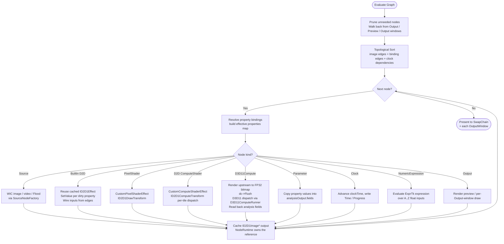

# Topological Evaluation

A cycle, through image edges or property bindings (`TopologicalSort`, `Connect` and `BindProperty` all follow both, through `GraphModel::ForEachDependency`), leaves no order to evaluate in. `Connect` and `BindProperty` refuse one; a loaded file can still carry one. `Evaluate` then sets a cycle `runtimeError` on every node the cycle holds back (`GraphModel::UnorderableNodes`) and returns no image, and clears that error once the graph sorts again.

The evaluator runs at the **monitor's refresh rate** (clamped to 60–240 Hz) on the **render worker thread**. The UI thread starts a `DispatcherQueueTimer` whose interval is set from `EnumDisplaySettings(ENUM_CURRENT_SETTINGS).dmDisplayFrequency`, but its only per-tick job is to drain the dispatcher queue (handling MCP / user commands) and blit the latest published offscreen to the SwapChainPanel-bound swap chain. The actual graph evaluate runs on the worker, dirty-gated (`Evaluate` is skipped entirely unless any node is dirty, an output window is open, the preview wants a fit, or `m_forceRender` was set by user input). The interval is re-applied on every display change (so dragging the window across monitors picks up the new rate). See [Threading Model](threading-model.md).

## Where the evaluator lives

`Rendering::GraphEvaluator` is an exported facade holding one pointer to `Rendering::Evaluator::EvaluatorCore`, so changing the evaluator's internals no longer changes the engine's ABI (decisions #168, #169). The core is one class split across files by seam:

| File (`Rendering/Evaluator/`) | Holds |
|---|---|
| `EvaluatorCore.cpp` | `Evaluate`: the pull-dirty walk and one visitor per node kind (`VisitSource`, `VisitBuiltIn`, `VisitParameterNode`, `VisitOutput`; the other two below) |
| `CustomEffectNode.cpp` | custom D2D pixel / compute shaders: baseline auto-compile, `InjectHostDimensions` (OutputW/H, ImageAW..DH), `ApplyCustomEffect` (build choice, reserved pins, cbuffer) |
| `ComputeScheduler.cpp` | D3D11 compute: `QueueD3D11Compute`, `ProcessDeferredCompute` (readback plan, shared pre-render, ordered dispatch), `DispatchViaBridge` |
| `EffectFactory.cpp` | `GetOrCreateEffect`, `ApplyProperties`, `WireInputs`, placeholder bitmaps |
| `AnalysisReadback.cpp` | Histogram and custom-analysis readback, async readback polling, lane-3 texture views |
| `CachePolicy.cpp` | `D2D1_PROPERTY_CACHED` policy, `ReleaseCache`, `InvalidateNode`, `UpdateNodeShader` |
| `VariantSelector.{h,cpp}` | build choice and option precompile (`Select`, `QueueOptionVariants`, `Poll`), `CompileBaseline`, the content-addressed bytecode and reflection memos |
| `BindingResolver.{h,cpp}` | property-binding resolution and the non-finite-safe write-back |
| `ParameterNodes.{h,cpp}` | Clock / Math Expression / Random / constant fields; no device |
| `ComputeDispatch.{h,cpp}` | compute cbuffer packing, output size from properties, per-pixel thread-group counts; no device |
| `NodeRuntime.h`, `InputPins.h` | per-node state; the lane-3 pin layout |

Everything kept per node is one `NodeRuntime` record keyed by node id: the effect instance (effect, output, impl pointers, cache flag), its variant state, its lane-3 texture view and pending async readback -- which `InvalidateNode` and a shader update drop together -- plus what outlives an instance: pre-render targets, the hint-throttle timestamp, a pending fresh-readback request and the output change count. A node removed from the graph loses its record at the next normal pass. State scoped to one pass (`PassState`: output and field changes, effects created) and to one frame's compute queue (`ComputeQueue`) are reset in one place each.

---

---

Back to [docs/](../README.md) • [Repo root](../../README.md)